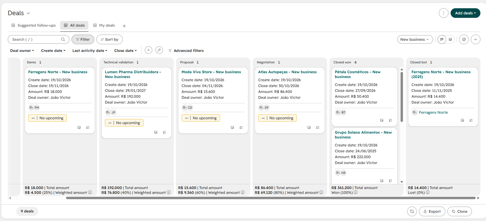
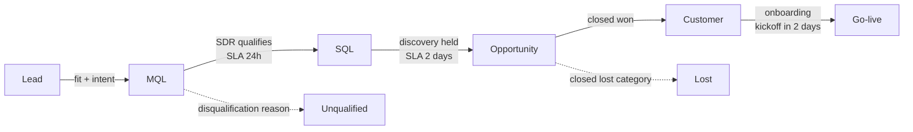
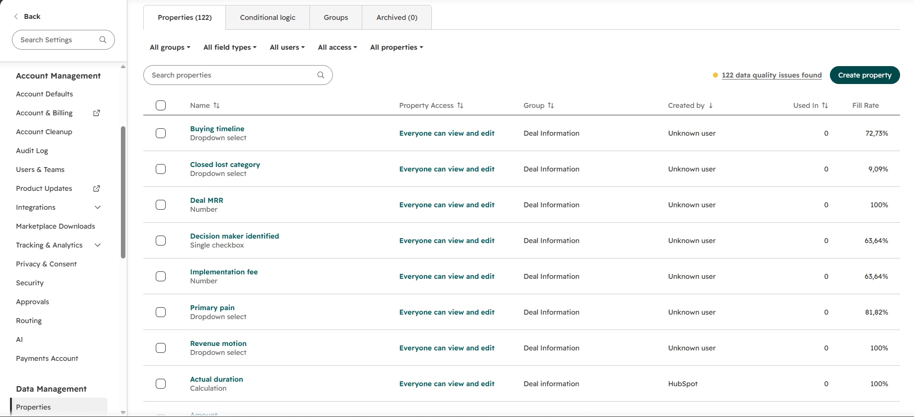
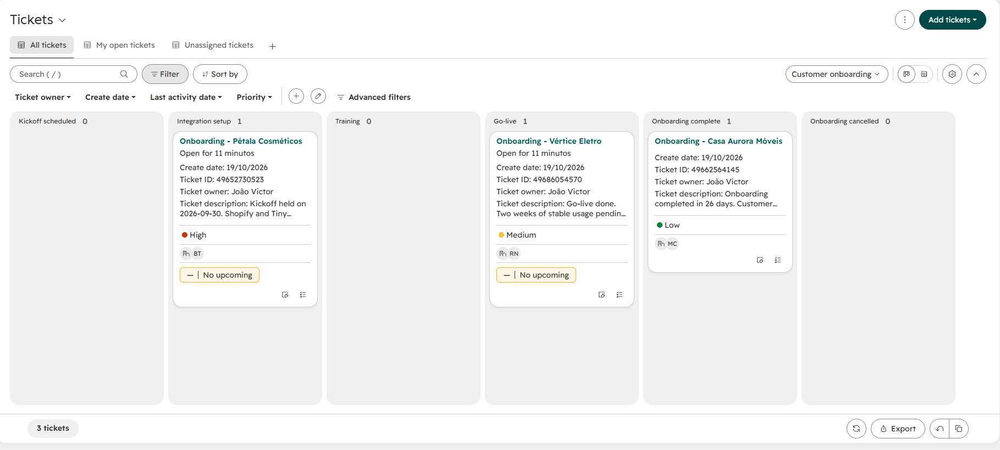
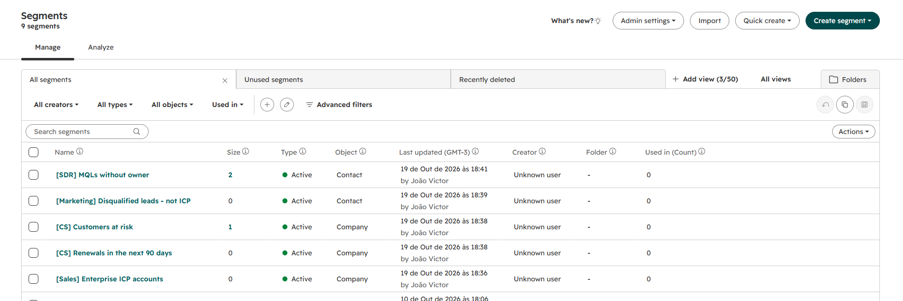

# HubSpot CRM Implementation: Rotalog

End-to-end **CRM implementation** for a fictitious B2B logtech, from discovery interviews to a configured HubSpot portal. Everything is designed as **configuration as code**: properties, pipelines and segments live in YAML files that are validated, documented automatically and applied to HubSpot.

> **The short version:** Rotalog grew from 30 to 120 customers on spreadsheets. Marketing didn't know which leads became revenue, two SDRs called the same lead, the forecast was a guess and Customer Success found out about new customers when they emailed asking for access. This project gives the four teams one funnel, one set of definitions and one source of truth.



---

## The story

### 1. Before: four teams, five versions of the truth

| Team | Pain |
|------|------|
| Marketing | Sends leads in a Monday spreadsheet and never hears back |
| SDR | No queue, duplicate calls, slow first response |
| Sales | Each AE has their own deal file, so the forecast is a guess |
| Customer Success | Learns about new customers too late; no view of renewals or churn risk |

Interviews turned these pains into **14 prioritized requirements** (MoSCoW): [docs/01_discovery.md](docs/01_discovery.md)

### 2. Agreeing on the funnel before touching the CRM

The most important deliverable is an agreement between the teams, not a property. I defined each lifecycle stage with entry criteria and an owner, set the handoffs and their SLAs, and made a reason required for every negative outcome.



Full definitions: [docs/02_funnel_and_slas.md](docs/02_funnel_and_slas.md)

### 3. Designing the CRM as code

| Item | Count | Where |
|------|-------|-------|
| Custom properties | 19 (4 contact, 8 company, 7 deal) | [config/properties.yaml](config/properties.yaml) |
| Pipelines | New business · Expansion and renewal · Customer onboarding | [config/pipelines.yaml](config/pipelines.yaml) |
| Dynamic segments | 5 work queues (SDR, Marketing, Sales, CS) | [config/segments.yaml](config/segments.yaml) |
| Teams and permissions | 5 teams, permission matrix and rules | [config/teams_and_permissions.yaml](config/teams_and_permissions.yaml) |
| Automations | 6 workflow specs plus pipeline rules | [docs/03_automation_specs.md](docs/03_automation_specs.md) |
| Dashboards | Reports per team, each tied to a decision | [docs/04_dashboard_specs.md](docs/04_dashboard_specs.md) |
| Governance | Naming, data quality rules, change management | [docs/05_governance.md](docs/05_governance.md) |

Some of the design decisions:

- **Logistics-specific firmographics** (monthly shipments, ERP, e-commerce platform) instead of only company size. A company with 50 employees and 20,000 shipments a month is a better fit than one with 500 employees and 300.
- **Deal MRR is separate from amount.** The forecast is built on recurring revenue, not on total contract value.
- **New business and expansion use separate pipelines**, so upsell doesn't inflate new-business conversion rates.
- **Every property has an owner and a requirement ID.** If nobody can say why a field exists, it doesn't get created.

### 4. Go-live and validation

The configuration was applied to a HubSpot test portal and checked against 33 sample records.

| Custom properties | Customer onboarding pipeline |
|---|---|
|  |  |



Right after creation, all 5 segments returned exactly the expected records. The open pipeline is **R$ 26,000 MRR**, with a **weighted forecast of R$ 13,315 MRR**.

Later, HubSpot re-saved three segment filters on its own, and those segments dropped to 0 members even though the records still match the filters (the screenshot above shows this state). It is logged as an open issue, with the investigation so far, in the go-live document.

**The first run already found a real gap.** Vértice Eletro is *at risk* and *renews in 83 days*, but has no renewal deal open. Without workflow W5, the account most likely to churn would be the one nobody is working on. Details: [docs/06_go_live_and_validation.md](docs/06_go_live_and_validation.md)

---

## How the code works

```
config/*.yaml ──▶ validate_config.py ──▶ generate_data_dictionary.py ──▶ docs/data_dictionary.md
                         │
                         └──▶ apply_to_hubspot.py ──▶ HubSpot (dry run by default, idempotent)
```

| Script | What it does |
|--------|--------------|
| `src/validate_config.py` | Checks naming conventions (snake_case names, Sentence case labels), duplicate names, dropdown options, links to requirements, increasing stage probabilities, and that every segment filter uses existing properties and options. Exits with an error, so it can run in CI. |
| `src/generate_data_dictionary.py` | Writes [docs/data_dictionary.md](docs/data_dictionary.md) from the YAML, so the documentation never drifts from the configuration. |
| `src/apply_to_hubspot.py` | Creates the properties and pipelines that are missing through the HubSpot CRM API. Shows the plan by default; `--apply` executes it, and items that already exist are skipped. |

```bash
pip install -r requirements.txt
python src/validate_config.py                 # validate the configuration
python src/generate_data_dictionary.py        # regenerate the data dictionary
export HUBSPOT_ACCESS_TOKEN=...               # private app token (test portal)
python src/apply_to_hubspot.py                # dry run: show what would change
python src/apply_to_hubspot.py --apply        # create what is missing
pytest -q                                     # tests
```

## Repository structure

```
config/   CRM configuration (single source of truth)
docs/     discovery, funnel, automations, dashboards, governance, go-live, data dictionary
src/      validator, documentation generator, HubSpot apply script
tests/    validator rules and apply-script behaviour (no network calls)
```

## Skills demonstrated

- **CRM implementation:** discovery, requirements, data model, pipelines, lifecycle design
- **Revenue Operations:** SLAs and handoffs between Marketing, SDR, Sales and CS; forecast design
- **Governance:** naming conventions, data quality rules, change management, permissions
- **Technical:** HubSpot CRM API, configuration as code (YAML), Python, automated tests

---

*Rotalog, its customers and all people and records in this project are fictitious.*
